# Oniks — ikas Studio theme

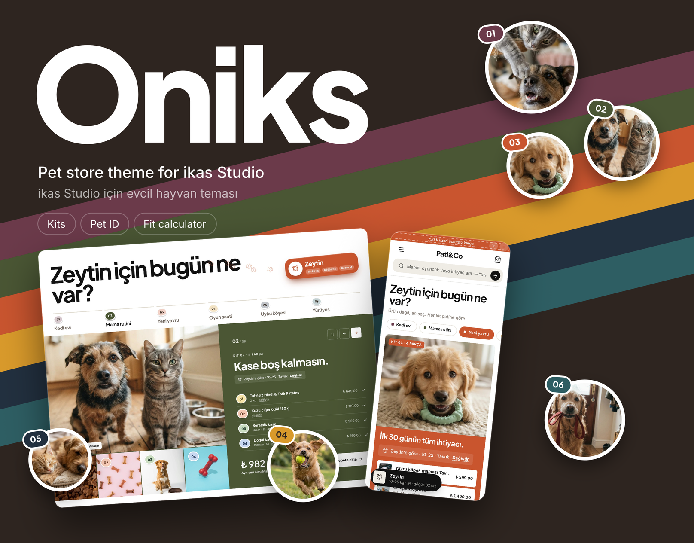

Evcil hayvan mağazaları için bir ikas teması. Bu sayfada temanın **öne çıkan kurguları** görsellerle anlatılıyor: editörde ya da panelde yaptığın ayarın sitede nasıl göründüğü.
*A pet store theme for ikas. This page shows the key setups: what you do in the editor or admin panel, and what happens on the site.*

**Temayı satın al / Get the theme:** https://themes.ikas.com/tr/temalar/50ee711b-652d-428e-bb3e-2709ba4aaf9d

**Canlı önizleme / Live preview:** https://dev-yozgat.ikas.shop

> Kit, Pet Kimliği, ürün sayfası, sepet ve ana sayfa görsellerinin alt kısmında o bölümün **editör paneli** çizili. Tablolardaki numaralar, editör kısmındaki koyu renkli işaretlerdir.
> *The lower part of the kit, Pet ID, product page, cart and home page images shows the editor panel; table numbers match the dark markers there.*

---

## 1. Kitler · Kits

Temanın en önemli özelliği. Alıcı tek tek ürün aramak yerine petinin gününden bir an seçer ("Mama rutini", "Yürüyüş") ve o anın ürünlerini tek tıkla sepete ekler.
*The shopper picks a moment and adds its products in one tap.*

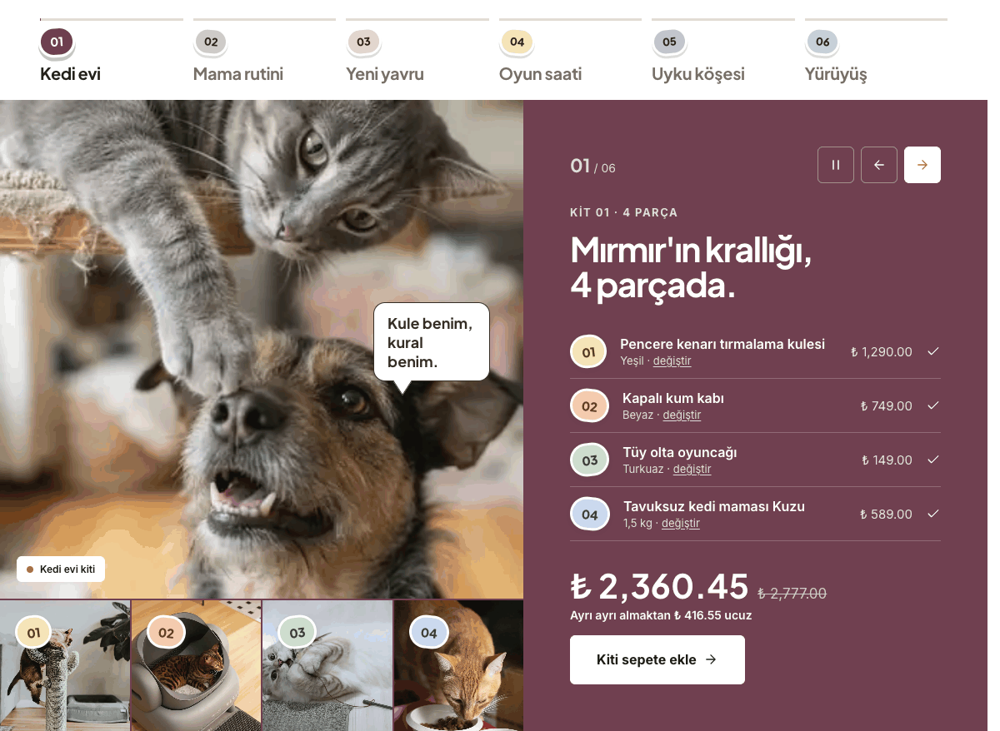

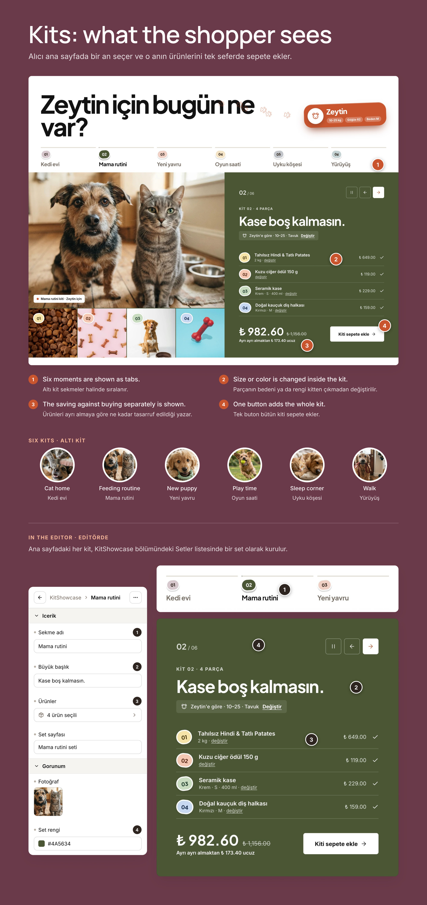

**Editörde:** Ana sayfa › KitShowcase bölümü › **Setler** › Set ekle.

| # | Editörde | Sitede |
|---|---|---|
| 1 | `Icerik › Sekme adı` | Kit sekmesindeki ad |
| 2 | `Icerik › Büyük başlık` | Kit panelindeki büyük yazı |
| 3 | `Icerik › Ürünler` | Kitin parçaları (ikas ürün listesi) |
| 4 | `Gorunum › Set rengi` | Panelin ve kit numarasının rengi |

**İndirim:** ikas paneli › Kampanyalar. Kitin ürünlerine **kuponsuz, oran (%) tipinde** bir kampanya aç ve en az ürün adedini gir (ör. 3 parçaya %15). Tema oranı ve adedi bu kampanyadan okur. Kampanya okunamazsa Header › Sepet çekmecesi › Ayarlar'daki "İndirim oranı (%)" ve "İndirim için en az ürün" kullanılır.
*The discount comes from a coupon-free ratio campaign in the ikas panel.*

**Kit sayfası:** editörde yeni bir sayfa aç, KitHero ve KitProducts bölümlerini ekle. KitProducts kademe çubuğunu ("1 ürün daha seç, %15 indirim kazan") kampanyadan çizer.

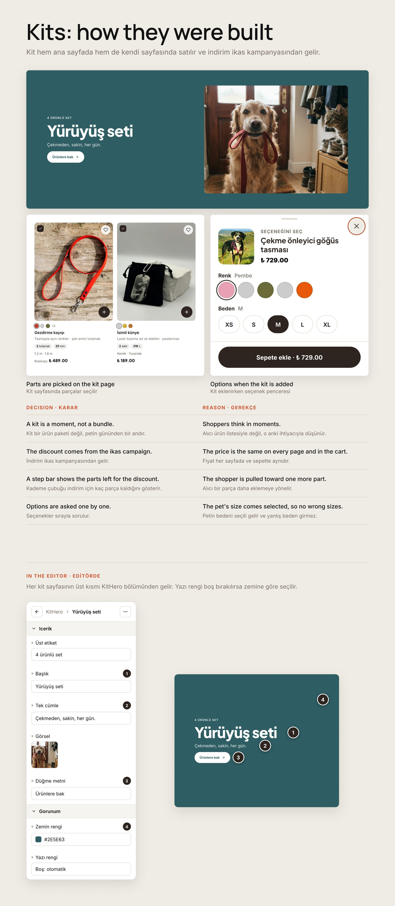

| # | Editörde | Sitede |
|---|---|---|
| 1 | `KitHero › Icerik › Başlık` | Kit sayfasının büyük başlığı |
| 2 | `KitHero › Icerik › Tek cümle` | Başlığın altındaki cümle |
| 3 | `KitHero › Icerik › Düğme metni` | Düğmedeki yazı |
| 4 | `KitHero › Gorunum › Zemin rengi` | Üst alanın zemini (yazı rengi boşsa zemine göre seçilir) |

---

## 2. Pet Kimliği · Pet ID

Alıcı petini 10 saniyede tanıtır (tür, kilo, ad). Ürün listeleri pete uyanları önce gösterir, ürün sayfası bedeni önerir, sepet her ürünü pete göre kontrol eder. Bilgi yalnız alıcının tarayıcısında tutulur; üyelik gerekmez.
*Products that fit the pet come first, the size is suggested and the cart checks every product.*

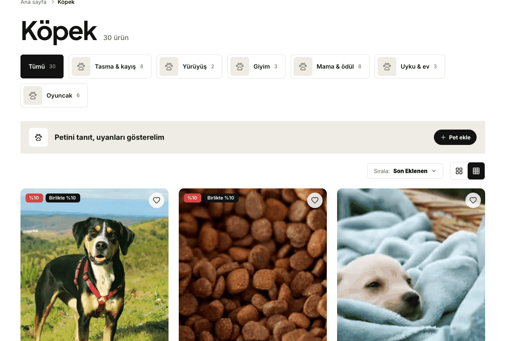

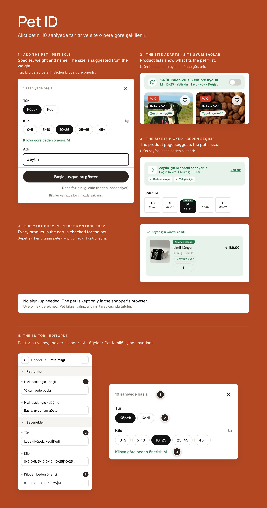

**Editörde:** Header › Alt öğeler › **Pet Kimliği**. Tür, yaş, kilo, beden ve hassasiyet seçenekleri, kilodan beden önerisi, cinsler ve porsiyon hesabı buradadır. Editörde görünen "Pet ayarları kontrolü" kutusu hatalı satırları gösterir.

| # | Editörde | Sitede |
|---|---|---|
| 1 | `Pet formu › Hızlı başlangıç · başlık` | Formun başlığı |
| 2 | `Seçenekler › Tür` | Tür seçenekleri |
| 3 | `Seçenekler › Kilodan beden önerisi` | Kiloya göre önerilen beden |

**Panelde (ürün etiketleri):** eşleşme ürün etiketlerinden okunur.

| Etiket | Anlamı |
|---|---|
| `tur:kopek`, `tur:kedi` | Hangi tür için |
| `evre:yavru`, `evre:yetiskin`, `evre:yasli` | Hangi yaş evresi için |
| `kilo:10-25` | Hangi kilo aralığı için |
| `icermez:tavuk` | "Tavuk içermez" badge'i |
| `icerik:tavuk` | Hassasiyeti olan pete uyarı |

---

## 3. Ürün sayfası · Product page

Önerilen beden, beden seçicide petin işareti, "Yanına ekle" ürünleri, kargo ve iade notları. Altında uyum hesaplayıcı ve mama geçiş planı var.
*Suggested size, add-alongside products, a portion calculator and a food transition plan.*

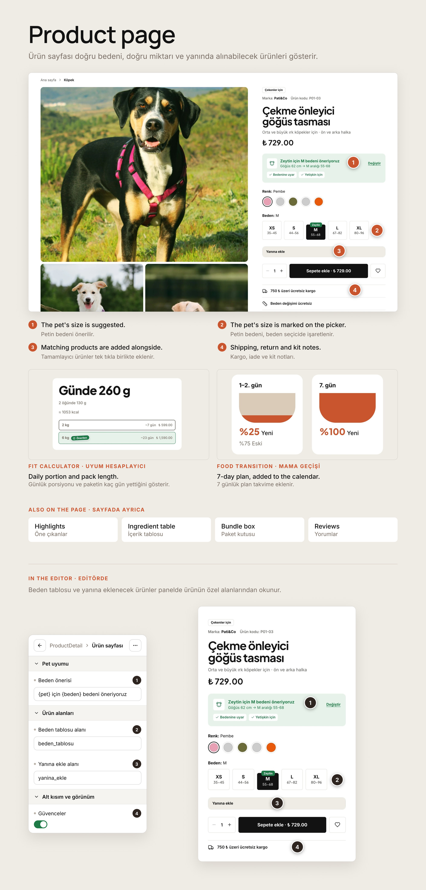

**Panelde (ürün özel alanları):**

| Özel alan | Biçim | Sitede |
|---|---|---|
| `beden_tablosu` | `XS\|35-45; S\|44-56` | Beden önerisi |
| `besleme_tablosu` | `5-10\|110-170; 10-20\|170-280` | Günlük porsiyon |
| `yanina_ekle` | Ürün tipi alan (1–3 ürün) | "Yanına ekle" ürünleri |
| `alt_baslik` | Metin | Başlık altındaki satır |

| # | Editörde | Sitede |
|---|---|---|
| 1 | `Pet uyumu › Beden önerisi` | Pete önerilen beden kutusu |
| 2 | `Ürün alanları › Beden tablosu alanı` | Beden seçici ve petin işareti |
| 3 | `Ürün alanları › Yanına ekle alanı` | "Yanına ekle" ürünleri |
| 4 | `Alt kısım ve görünüm › Güvenceler` | Kargo, iade ve kit notları |

**Editörde:** Ürün sayfası › ProductDetail › Ürün alanları (alan adları burada değiştirilebilir). Mama geçiş planı: TransitionPlan bölümü › **Tetikleyici etiket** (ör. `mama`) ve **Adımlar** (`1–2. gün|25; 3–4. gün|50; …`). Plan yalnız bu etiketi taşıyan ürünlerde görünür.

---

## 4. Sepeti büyüten kurgular · Growing the basket

Ücretsiz kargo çubuğu, kit indirimi çubuğu, sepette her kampanyanın ayrı satırı ve indirim kodu, Görünümü satın al bölümünde "hepsini ekle", hediye paketi ve "Sepetini tamamla".
*Free shipping bar, discount bar, campaign lines, coupon, gift wrap and cart suggestions.*

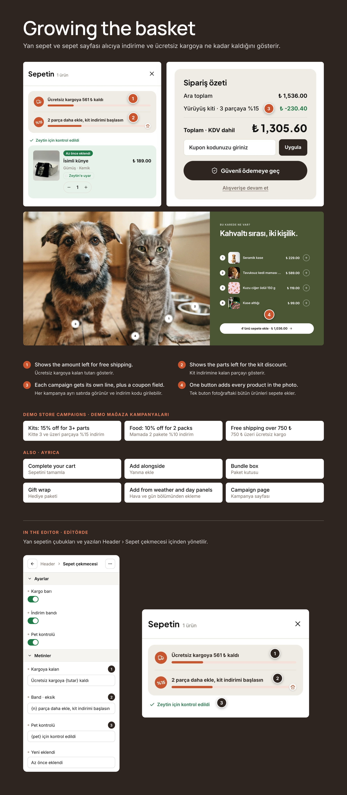

| Kurgu | Editörde |
|---|---|
| Yan sepet çubukları ve önerileri | Header › Sepet çekmecesi › Ayarlar (Kargo barı, İndirim bandı, Pet kontrolü, Sepetini tamamla) |
| Ücretsiz kargo eşiği | Tema ayarları (demo: 750 ₺) |
| Sepet sayfası, hediye paketi | CartPage › Ayarlar › Hediye paketi ürünü |
| Görünümü satın al | ShopTheLook › Noktalar (ürün + fotoğraftaki yeri) |

| # | Editörde | Sitede |
|---|---|---|
| 1 | `Sepet çekmecesi › Metinler › Kargoya kalan` | Ücretsiz kargoya kalan tutar |
| 2 | `Sepet çekmecesi › Metinler › Band · eksik` | Kit indirimine kalan parça |
| 3 | `Sepet çekmecesi › Metinler › Pet kontrolü` | Pet kontrolü satırı |

---

## 5. Ana sayfa bölümleri · Home page sections

On bölüm; sırası editörden değişir.
*Ten sections; the order is set in the editor.*

| Bölüm | Editörde öne çıkan ayar |
|---|---|
| Kit paneli | Setler, otomatik geçiş |
| Ürün slider'ı | Ürün listesi, köpek / kedi sekmesi |
| Hava durumu bandı | Şehirler (`ad\|enlem\|boylam`), her hava için ürün listesi |
| Görünümü satın al | Görsel ve noktalar |
| Pete seçilenler | Ürün listesi |
| Evin bir günü | Anlar (saat, başlık, ürünler, renk) |
| Kit grid'i | Ürün listesi ve kit linki |
| Sahadan fotoğraflar | Polaroid görselleri ve notları |
| Yorumlar | Yorum kartları |
| Son yazılar | Blog |

### Hava durumu bandı · Weather band

| # | Editörde | Sitede |
|---|---|---|
| 1 | `Hava ve şehir › Durum satırı` | Şehir, sıcaklık ve hava durumu |
| 2 | `Açık / ılık › Başlık` | O havanın başlığı |
| 3 | `Açık / ılık › Ürünler` | O havada gösterilen ürünler |

Yağmur, kar, sıcak ve soğuk için başlık ve ürünler ayrı girilir. Şehirler `ad|enlem|boylam` biçiminde yazılır; ilk şehir varsayılandır.

### Görünümü satın al · Shop the look

| # | Editörde | Sitede |
|---|---|---|
| 1 | `Metinler › Başlık` | Panelin başlığı |
| 2 | `Görsel ve noktalar › Noktalar` | Fotoğraftaki numaralı noktalar (her biri ürün + konum) |
| 3 | `Metinler › Hepsini ekle` | Bütün ürünleri ekleyen düğme |
| 4 | `Görünüm › Zemin` | Panelin rengi |

### Evin bir günü · A day at home

| # | Editörde | Sitede |
|---|---|---|
| 1 | `DayTimeline › Başlık (pet var)` | Bölümün başlığı (petin adıyla) |
| 2 | `Anlar › An › Başlık` | Anın başlığı |
| 3 | `Anlar › An › Kit linki metni` | Anın kit linki |
| 4 | `Anlar › An › Panel rengi` | Panelin rengi |

---

## 6. Renkler ve kit renkleri · Colors and kit colors

Temada renk şeması yerine her kitin kendi rengi var. Genel renkler ve yazı tipleri Stil panelinden değişir.
*Each kit has its own color; global colors and fonts are in the Style panel.*

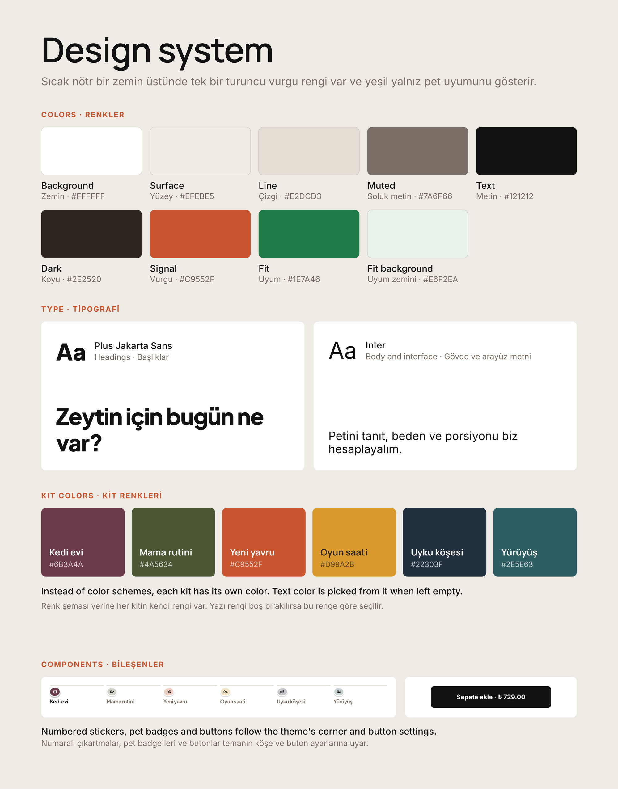

**Editörde:** Stil › Renkler ve Yazı tipleri. Kit rengi: KitShowcase › Setler › Set rengi; kit sayfasında KitHero › Zemin rengi (yazı rengi boşsa zeminden seçilir).

---

## 7. Mobil · Mobile

Kit çipleri yana kayar, pet şeridi altta kalır, seçenekler alttan açılan bir panelde gösterilir. Logo boyutu ve hizası telefon için ayrı ayarlanır (Header › Üst alan › Logo ve simgeler).
*The same flow on the phone; logo size and alignment have their own phone settings.*

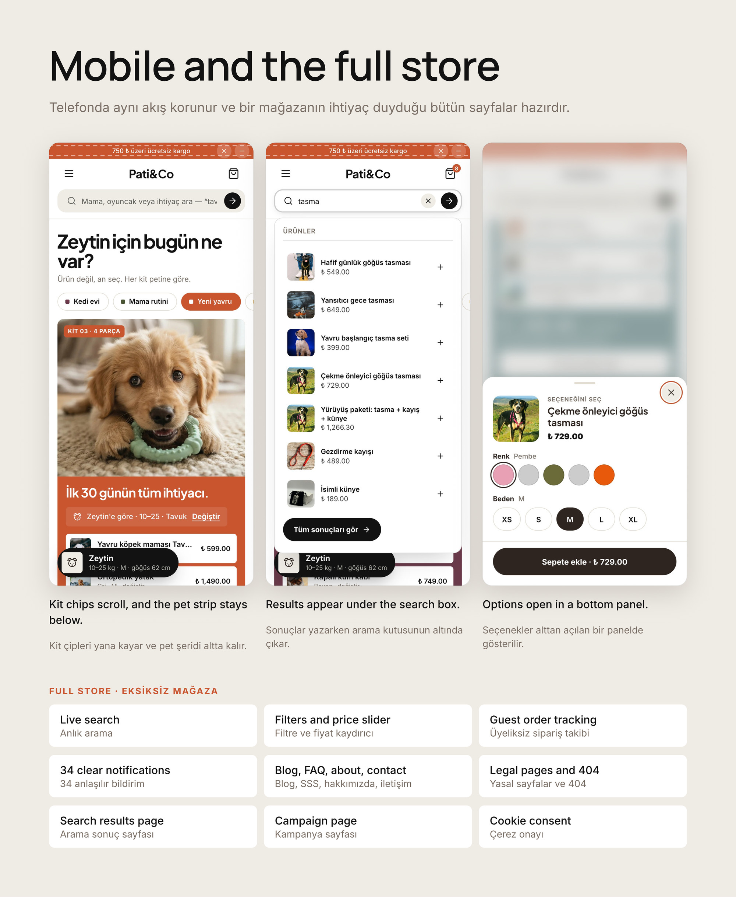

---

## 8. Panel → site ve editörde açık / sabit · Panel to site

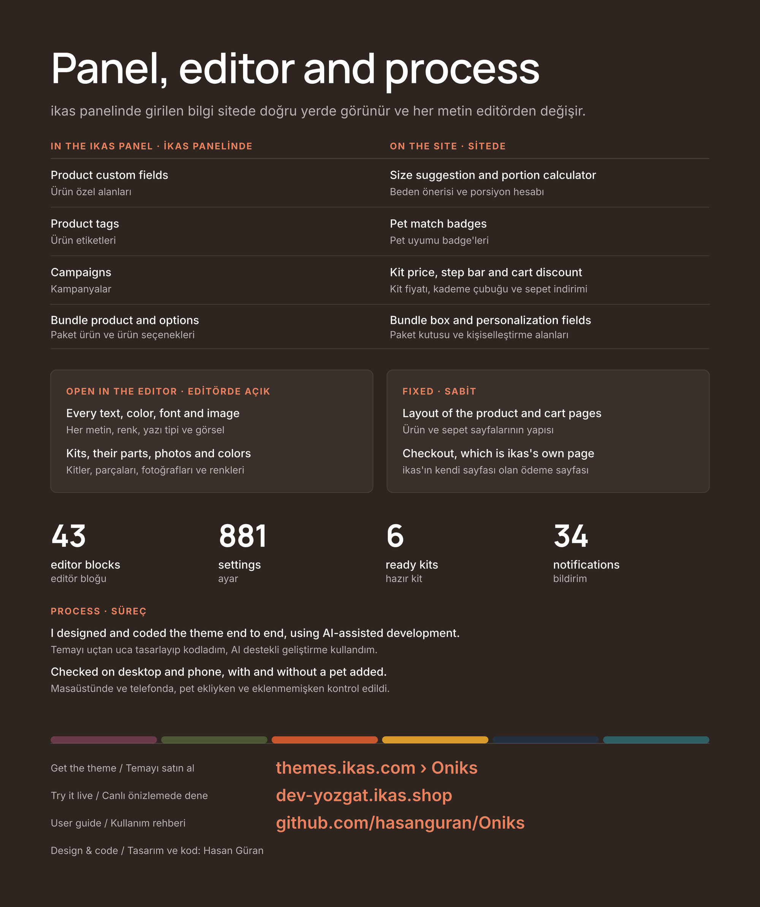

| Açık (editörden değişir) | Sabit |
|---|---|
| Her metin, renk, yazı tipi ve görsel | Ürün ve sepet sayfalarının yapısı |
| Kitler, parçaları, fotoğrafları ve renkleri | Ödeme sayfası (ikas'ın kendi sayfası) |

---

Tasarım ve kod: Hasan Güran · Lisans: CC BY 4.0 (yalnız bu rehber ve görseller)
*Design and code: Hasan Güran · License: CC BY 4.0 (this guide and its images only)*
